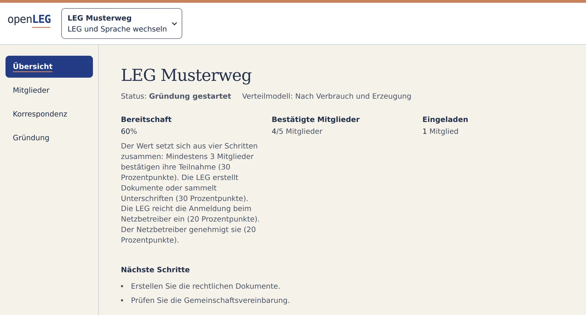
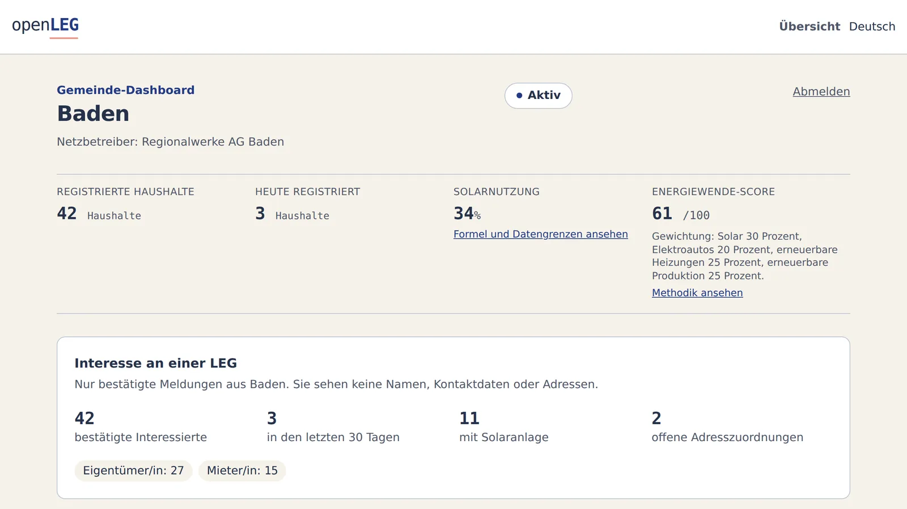

# OpenLEG

<div align="center">

<picture>
  <source media="(prefers-color-scheme: dark)" srcset=".github/assets/openleg-wordmark-dark.svg">
  
</picture>

[Website](https://openleg.ch) · [Docs](docs/architecture.md) · [Contribute](docs/contributor-onboarding.md) · [Discussions](https://github.com/Open-LEG-ch/openleg/discussions) · [Milestones](https://github.com/Open-LEG-ch/openleg/milestones)

[](https://github.com/Open-LEG-ch/openleg/actions/workflows/deploy.yml)
[](https://github.com/Open-LEG-ch/openleg/actions/workflows/lint.yml)
[AGPL-3.0-or-later](https://www.gnu.org/licenses/agpl-3.0.html)

</div>

[English](#english) | [Deutsch](#deutsch)

Free, open-source software for local electricity communities (LEG) in Switzerland. Kostenlose Open-Source-Software für lokale Elektrizitätsgemeinschaften (LEG) in der Schweiz.

## English

OpenLEG is the public website, app and API for setting up and running a local
electricity community (LEG) in Switzerland. In a LEG, neighbours share
electricity produced nearby, for example by solar panels on their roofs. The
private `openleg-ops` repository handles production deployment. It does not own
the code that runs the public website, or its assets.

To try OpenLEG without real data, run `python scripts/sandbox.py` and follow the
[fictional village sandbox](docs/sandbox.md) guide. Each visitor gets their own
throwaway village with demo accounts. Mail goes to a simulated inbox, and
signatures and the VNB are simulated locally. You can register a household, set an energy
profile, give neighbour consent, manage contacts, and export or delete a profile.
You can form a LEG, confirm its activation and add a participant who joins on a
set date. As Sam or Robin, you can import fictional E66 metering files, see how
the app refuses bad input and handles corrections, and retry a local scheduled
job. The guide walks through each of these.

### Product preview

These are demo pages from the current app with fictional data, not production
screenshots.





### Operating model

The LEG chooses its representative, participant agreements, internal energy
price, administration, billing operator and hosting provider. OpenLEG provides
the software for this work. Anyone can inspect it and host it themselves under
AGPL-3.0-or-later.

The distribution system operator (VNB) keeps its legal duties. It checks the
network-area and network-level requirements, does the metering, charges for
network use with the legal discount, and delivers the data assigned to it. Where
needed, the basic supplier delivers the remaining electricity. OpenLEG does not
take over any of these duties. Formation submissions and data delivery have to be
set up for each VNB, and an end-to-end connection is not available for every VNB.

The current code covers formation records, VNB handovers, participant changes, scheduled SDAT ingestion, quarter-hour allocation, tariff versions, invoice approval, immutable invoices, payment reconciliation, and operational archive export and restore.

The [community archive guide](docs/community-archive.md) explains its dataset scope, destination checks and restore requirements.
Community activation requires recorded VNB start evidence and an explicit
administrator action on or after the confirmed date. See the
[operating-start workflow](docs/vnb-exchange.md#confirmed-operating-start).

The admin API can withdraw a VNB calculated-values delivery while preserving its source and audit record. Dependent drafts become invalid; issued invoices remain unchanged. The [data pipeline guide](docs/data-pipeline.md#withdrawal-of-calculated-vnb-evidence) documents correction and retry handling.

### What this repo is

- `app.py` connects the Flask routes and user journeys
- `api_public.py` provides the public JSON API
- `database.py` owns connections and migrations; `store/` contains domain repositories
- `billing_engine.py` contains quarter-hour allocation and draft billing logic
- `templates/`, `static/`, and `tests/` contain the interface and its checks

### Choose your path

| You are | Start here | What you can do |
| --- | --- | --- |
| Owner or founder | `/dashboard` | Open the owner dashboard and organise a LEG. |
| LEG operator | `/leg/dashboard` | Manage members, contracts, metering, and billing. |
| Municipality | `/gemeinde/dashboard` | Open the municipality dashboard. |
| Developer or self-hoster | `/api/v1/docs` | Use the API or run your own instance. |

Verified owners can keep private solar equipment records and a checklist for
their model at `/dashboard/equipment`, without LEG membership or telemetry.
Cloud-access reviews and backup evidence remain separate. Owners can download a
redacted installer handoff. OpenLEG does not verify the entered claims or change
devices.

Owners with enrolled telemetry installations can open `/dashboard/telemetry`
to see source readings, quality, observation time, age and device-reported faults.
The LEG dashboard links to explicitly shared power readings with coverage and
exclusion counts. Sums exclude overlapping profiles and require at least three
synchronized eligible profiles.
Device-specific fault mappings and hardware/user-pilot validation remain tracked
in [#617](https://github.com/Open-LEG-ch/openleg/issues/617).

Equipment pages also show private matches against an explicitly reviewed
advisory catalog. The catalog starts empty with notices disabled. A named source
reviewer, review cadence and successful source review are required before
enabling notices. Unknown firmware remains unresolved; no match is not a safety
assessment. See [advisory review and owner notices](docs/advisories.md).

Municipality profiles, the directory, and the municipality dashboard distinguish
zero confirmed expressions of interest from temporarily unavailable counts. When
counts cannot be loaded, interest sorting falls back to sorting by name. Public
counts of one or two remain hidden as `< 3`.

### From meter reading to invoice

The path from raw metering data to a member invoice runs as one workflow in this repository:

1. **Import.** `scripts/fetch_sdat.py` collects SDAT files from the Swisseldex Datahub, `scripts/import_sdat.py` parses ebIX E66 documents into `store/metering.py`; `sdat_datahub.py` and `sdat_e66.py` hold the transport and parsing logic, `scripts/sdat_pipeline.sh` chains the steps. `scripts/import_metering_points.py` maps metering points to buildings.
2. **Allocation.** `billing_readings.py` turns point-keyed readings into participant frames and refuses a period it cannot bill. `billing_engine.py` allocates the quarter hours and produces an auditable draft with positive `consumer_charge` items and negative `producer_credit` items; `store/billing.py` persists period, price snapshot, and signed line items. `billing_runner.py` orchestrates one period, and `POST /api/cron/process-billing` in `cron.py` runs the previous complete month for every active community.
3. **Policy and approval.** The operator maintains a versioned tariff at `/leg/community/<community_id>/billing-policy` (`billing_policy.py`, `templates/leg_billing_policy.html`) and reviews the draft at `/leg/community/<community_id>/billing` (`templates/leg_billing.html`). Approval freezes one immutable invoice per participant from the persisted policy snapshot (`billing_approval.py`).
4. **Lifecycle and delivery.** An issued invoice moves through `issued`, `delivered`, `paid`, `cancelled`, and `corrected` (`billing_lifecycle.py`). Members read their own invoices at `/dashboard/invoices`, `/dashboard/invoices/<invoice_id>`, and `/dashboard/invoices/<invoice_id>/pdf` (`member_invoices.py`, `templates/member_invoices.html`, `templates/member_invoice_detail.html`).

Invoice approval stays a deliberate operator action. VNB-specific transport and credentials require local configuration.
Formation documents and invoice PDFs support German and Swiss French labels;
stored invoice figures and existing formation files remain unchanged. See
[document language behavior](docs/internationalization.md#printable-documents).
Residents can save German or Swiss French for the four scheduled onboarding
emails and municipality interest notices in their private dashboard. Unresolved
address confirmations use the language chosen at signup. Resident confirmation
and login links, plus issued invoice notices and deletion confirmations, use the
addressed record's saved choice.
Existing registrations default to German;
changing the page language alone does not change a saved preference. See
[recipient language](docs/internationalization.md#recipient-language).

Complete E66 LEG deliveries can also enter the calculated-values evidence path
directly. An administrator records explicit meter-assignment validity, then
uploads the original XML to `/admin/vnb-calculated-values/<territory>/e66`.
The import saves source evidence, physical readings and the import ledger in one
transaction. [E66 operator setup](docs/vnb-exchange.md#e66-calculated-values-evidence)
describes supported channels, quality restrictions and correction handling.
For proportional billing without a battery, an exact interval audit can explain
source rounding while invoices use the VNB quantities. Consumer and producer
totals must balance exactly. The [rounding policy](docs/data-pipeline.md#rounded-e66-allocation-evidence)
describes approval checks and unsupported cases.

### Quick start

```bash
python3 -m venv .venv
source .venv/bin/activate
pip install -r requirements-dev.txt
cp .env.example .env
pytest tests/ -q
python app.py
```

The dev server listens on the port from `APP_BASE_URL` in `.env` (default 5003).

For self-hosting:

```bash
curl -fsSL https://openleg.ch/install.sh | bash
```

Or use Docker directly:

```bash
cp .env.example .env
docker compose up -d
docker compose ps
```

### Public architecture

- Backend: Flask on Python 3.11
- Database: PostgreSQL 16
- Cache: Redis 7
- Reverse proxy: Caddy

Read the [engineering contract](docs/engineering-contract.md), [architecture](docs/architecture.md), [data pipeline](docs/data-pipeline.md), [dashboard access](docs/dashboard-access.md), and [API examples](docs/api-examples.md).

### Route map

- `/` public website for anonymous visitors
- `/login` role chooser for owners and municipalities
- `/dashboard` owner dashboard and secure access request; signed-in founders can create a LEG at `/leg/community/create`
- `/leg/dashboard` LEG operator dashboard
- After VNB submission, a confirmed LEG administrator can record the actual VNB start confirmation from the correspondence journal and explicitly activate the LEG on or after its confirmed start date. See [VNB exchange](docs/vnb-exchange.md).
- `/gemeinde/dashboard` municipality dashboard and secure access request
- `/utility/login` grid-operator login
- `/api/v1/docs` public API documentation
- `/health` and `/livez` runtime checks

### Data pipeline

Public data fetchers live in `public_data.py`. Database persistence uses `database.py` and `store/`. The PV ranking import is `scripts/load_pv_data.py`; SDAT retrieval from the Swisseldex Datahub lives in `sdat_datahub.py` and `scripts/fetch_sdat.py`. API read paths live in `api_public.py` and the ranking blueprints.

### Contributing

German and Swiss French are available through the language selector. To default
a self-hosted instance to French, set `BABEL_DEFAULT_LOCALE=fr_CH`. See the
[internationalization guide](docs/internationalization.md) for translation coverage,
catalog maintenance and adding further languages.

New to the codebase? Follow the [contributor onboarding guide](docs/contributor-onboarding.md).

Open an issue before a larger change. Keep the pull request small, start with a failing test, and run:

```bash
scripts/tdd_cycle.sh gate
```

Required checks are `ci/lint`, `ci/test`, and `ci/security`.

### Repository boundary

Public product code belongs here. Production credentials, citizen data, host inventory, deployment runbooks, and internal planning stay outside this repository. The public repo publishes container images; it never deploys production.

### Security

Never commit credentials or personal data. Use `.env.example` locally and report vulnerabilities through the repository security workflow.

## Deutsch

OpenLEG ist die öffentliche Website, App und API, mit der Sie in der Schweiz eine
lokale Elektrizitätsgemeinschaft (LEG) gründen und betreiben. In einer LEG teilen
Nachbarinnen und Nachbarn Strom, der in der Nähe erzeugt wird, zum Beispiel von
Solaranlagen auf ihren Dächern. Das private Repo `openleg-ops` übernimmt das
Deployment in die Produktion. Der Code der öffentlichen Website und ihre Assets
gehören nicht dazu.

### Betriebsmodell

Die LEG wählt ihre Vertretung, Teilnehmerverträge, den internen Strompreis, die
Administration, den Abrechnungsdienstleister und den Hosting-Anbieter. OpenLEG
stellt die Software für diese Aufgaben bereit. Alle können sie unter
AGPL-3.0-or-later prüfen und selbst betreiben.

Der Verteilnetzbetreiber (VNB) behält seine gesetzlichen Aufgaben. Er prüft die
Anforderungen an Netzgebiet und Netzebene, übernimmt die Messung, verrechnet die
Netznutzung mit dem gesetzlichen Rabatt und liefert die ihm zugewiesenen Daten.
Wo nötig liefert der Grundversorger den übrigen Strom. OpenLEG übernimmt keine
dieser Aufgaben. Anmeldung und Datenlieferung müssen für jeden VNB eingerichtet
werden. Eine durchgängige Anbindung gibt es noch nicht für jeden VNB.

Der aktuelle Code deckt Gründungsunterlagen, VNB-Übergaben, Teilnehmeränderungen, den zeitgesteuerten SDAT-Abruf, die Viertelstundenverteilung, Tarifversionen, Rechnungsfreigabe, unveränderliche Rechnungen, Zahlungsabgleich sowie Export und Wiederherstellung der Betriebsdaten ab.

Die [Archivanleitung](docs/community-archive.md) beschreibt die enthaltenen Datensätze, die Prüfung des Zielsystems und die Voraussetzungen für die Wiederherstellung.
Die Aktivierung einer Gemeinschaft verlangt einen erfassten VNB-Startbeleg
und eine ausdrückliche Handlung der Administration ab dem bestätigten Datum.
Der [Startablauf](docs/vnb-exchange.md#confirmed-operating-start) beschreibt die Schritte.

Über die Admin-API können Betreiber berechnete VNB-Werte zurückziehen. Quelle und Prüfverlauf bleiben erhalten. Abhängige Entwürfe verlieren ihre Gültigkeit; ausgestellte Rechnungen bleiben unverändert. Die [Datenpipeline](docs/data-pipeline.md#withdrawal-of-calculated-vnb-evidence) dokumentiert Korrekturen und Wiederholungen.

### Was dieses Repo enthält

- `app.py` verbindet Flask-Routen und Nutzerwege
- `api_public.py` stellt die öffentliche JSON-API bereit
- `database.py` besitzt Verbindungen und Migrationen; `store/` enthält die fachlichen Repositories
- `billing_engine.py` enthält Logik für Viertelstundenverteilung und Abrechnungsentwürfe
- `templates/`, `static/` und `tests/` enthalten Oberfläche und Prüfungen

### Wählen Sie Ihren Einstieg

| Sie sind | Einstieg | Das können Sie tun |
| --- | --- | --- |
| Eigentümer oder Gründer | `/dashboard` | Eigentümer-Dashboard öffnen und eine LEG organisieren. |
| LEG-Betreiber | `/leg/dashboard` | Mitglieder, Verträge, Messung und Abrechnung verwalten. |
| Gemeinde | `/gemeinde/dashboard` | Gemeinde-Dashboard öffnen. |
| Entwickler oder Selbsthoster | `/api/v1/docs` | API nutzen oder eigene Instanz betreiben. |

Bestätigte Eigentümer erfassen unter `/dashboard/equipment` private Solargeräte
und eine Checkliste für ihr Modell, auch ohne LEG-Mitgliedschaft oder Telemetrie.
Cloud-Zugriffe und Ersatzstromnachweise bleiben getrennt. Eigentümer können eine
bereinigte Übergabe für den Installateur herunterladen. OpenLEG prüft die Angaben
nicht und verändert keine Geräte.

Eigentümer mit angemeldeten Telemetrie-Anlagen sehen unter
`/dashboard/telemetry` ihre Messwerte mit Quelle, Qualität, Messzeit und Alter.
Die Ansicht zeigt auch gemeldete Gerätestörungen. Das LEG-Dashboard verlinkt
ausdrücklich freigegebene Leistungswerte mit Angaben zu Abdeckung und Ausschlüssen.
Summen schliessen Profile mit überlappenden Quellen aus und erfordern mindestens
drei geeignete Profile mit gleicher Messzeit.
Gerätespezifische Störungszuordnungen und die Prüfung mit Hardware und Pilotnutzern
bleiben in [#617](https://github.com/Open-LEG-ch/openleg/issues/617) offen.

Die Geräteseiten zeigen auch private Zuordnungen zu einem ausdrücklich geprüften
Hinweiskatalog. Er beginnt leer und mit ausgeschalteten Hinweisen. Vor dem
Einschalten braucht es eine benannte Quellenverantwortung, einen Prüfturnus und
eine erfolgreiche Quellenprüfung. Unbekannte Firmware bleibt ungeklärt. Ein
fehlender Treffer belegt nicht, dass die Anlage sicher ist. Siehe [Hinweiskatalog und Quellenprüfung](docs/advisories.md).

Gemeindeprofile, Verzeichnis und Gemeinde-Dashboard unterscheiden null bestätigte
Interessenmeldungen von vorübergehend nicht verfügbaren Zahlen. Können die Zahlen
nicht geladen werden, ersetzt das Verzeichnis die Sortierung nach Interesse durch
die Sortierung nach Namen. Öffentliche Zahlen von eins oder zwei bleiben als
`< 3` verborgen.

### Vom Zählerwert zur Rechnung

Der Weg von Rohmessdaten zur Mitgliederrechnung läuft als ein Ablauf in diesem Repo:

1. **Import.** `scripts/fetch_sdat.py` holt SDAT-Dateien vom Swisseldex Datahub, `scripts/import_sdat.py` liest ebIX-E66-Dokumente nach `store/metering.py`; `sdat_datahub.py` und `sdat_e66.py` enthalten Transport und Parsing, `scripts/sdat_pipeline.sh` verkettet die Schritte. `scripts/import_metering_points.py` ordnet Messpunkte den Gebäuden zu.

   Vollständige E66-LEG-Lieferungen lassen sich mit ausdrücklich bestätigter
   Messpunktzuordnung direkt als Berechnungsbeleg übernehmen. Der Admin-Endpunkt
   `/admin/vnb-calculated-values/<territory>/e66` speichert Originaldatei,
   Messwerte und Importprotokoll in einer Transaktion.
   [Einrichtung und Einschränkungen](docs/vnb-exchange.md#e66-calculated-values-evidence)
   beschreiben die unterstützten Kanäle und den Korrekturablauf.
   Bei proportionaler Abrechnung ohne Akku kann eine exakte Viertelstundenprüfung
   die Quellenrundung erklären; die Rechnung verwendet die VNB-Mengen. Verbrauchs-
   und Produktionssummen müssen exakt übereinstimmen. Die
   [Rundungsregel](docs/data-pipeline.md#rounded-e66-allocation-evidence) beschreibt
   Freigabeprüfungen und Einschränkungen.
2. **Verteilung.** `billing_readings.py` formt messpunktbezogene Werte in Teilnehmerreihen um und weist eine Periode zurück, die es nicht abrechnen kann. `billing_engine.py` verteilt die Viertelstunden und erzeugt einen prüfbaren Entwurf mit positiven `consumer_charge` Positionen und negativen `producer_credit` Positionen; `store/billing.py` speichert Periode, Preisstand und Positionen mit Vorzeichen. `billing_runner.py` steuert einen Lauf, `POST /api/cron/process-billing` in `cron.py` rechnet den letzten vollen Monat für jede aktive Gemeinschaft.
3. **Policy und Freigabe.** Die Betreiberin pflegt den versionierten Tarif unter `/leg/community/<community_id>/billing-policy` (`billing_policy.py`, `templates/leg_billing_policy.html`) und prüft den Entwurf unter `/leg/community/<community_id>/billing` (`templates/leg_billing.html`). Die Freigabe friert je Teilnehmer eine unveränderliche Rechnung aus dem gespeicherten Policy-Snapshot ein (`billing_approval.py`).
4. **Lebenszyklus und Zustellung.** Eine freigegebene Rechnung durchläuft `issued`, `delivered`, `paid`, `cancelled` und `corrected` (`billing_lifecycle.py`). Mitglieder lesen ihre Rechnungen unter `/dashboard/invoices`, `/dashboard/invoices/<invoice_id>` und `/dashboard/invoices/<invoice_id>/pdf` (`member_invoices.py`, `templates/member_invoices.html`, `templates/member_invoice_detail.html`).

Im LEG-Dashboard lassen sich Mitgliederverwaltung, Dokumente, Messdaten,
Abrechnungsvorbereitung, Freigabe und Prüfung getrennt delegieren. Optional
erzwingt die LEG für Rechnungen verschiedene Personen für Vorbereitung und
Freigabe. Mitglieder können zu ihrer eigenen Rechnung eine private Frage mit
PDF-Beleg eröffnen und den Status im Rechnungsdetail verfolgen.

Die Rechnungsfreigabe bleibt eine bewusste Entscheidung der Betreiberin. VNB-spezifischer Transport und Zugangsdaten müssen lokal eingerichtet werden.
Gründungsdokumente und Rechnungs-PDFs unterstützen deutsche und französische
Beschriftungen. Gespeicherte Rechnungsbeträge und vorhandene Gründungsdateien
bleiben erhalten. Die [Sprachdokumentation](docs/internationalization.md#printable-documents)
beschreibt das Verhalten.
Bewohnerinnen und Bewohner können im privaten Dashboard Deutsch oder Französisch
für die vier zeitversetzten Einstiegs-E-Mails und Gemeinde-Interessenmeldungen
speichern. Bestätigungen bei ungeklärten Adressen verwenden die Sprache der
Anmeldung. Bestätigungsmails und Zugangslinks zum Bewohnerdashboard verwenden
die gespeicherte Sprache, ebenso die Benachrichtigung über eine freigegebene
Rechnung und die Löschbestätigung für den jeweiligen Eintrag. Bestehende Anmeldungen
behalten Deutsch. Ein Sprachwechsel auf der Seite ändert diese Einstellung nicht.
Siehe [E-Mail-Sprache](docs/internationalization.md#recipient-language).

### Schnellstart

```bash
python3 -m venv .venv
source .venv/bin/activate
pip install -r requirements-dev.txt
cp .env.example .env
pytest tests/ -q
python app.py
```

Der Entwicklungsserver läuft auf dem Port aus `APP_BASE_URL` in `.env` (Standard 5003).

Für den Eigenbetrieb:

```bash
curl -fsSL https://openleg.ch/install.sh | bash
```

Oder direkt mit Docker:

```bash
cp .env.example .env
docker compose up -d
docker compose ps
```

### Öffentliche Architektur

- Backend: Flask auf Python 3.11
- Datenbank: PostgreSQL 16
- Cache: Redis 7
- Reverse Proxy: Caddy

Lesen Sie den [Entwicklungsvertrag](docs/engineering-contract.md), die [Architektur](docs/architecture.md), die [Datenpipeline](docs/data-pipeline.md), den [Dashboard-Zugriff](docs/dashboard-access.md) und die [API-Beispiele](docs/api-examples.md).

### Routen

- `/` öffentliche Website für nicht angemeldete Personen
- `/login` Rollenwahl für Eigentümer und Gemeinden
- `/dashboard` Eigentümer-Dashboard mit sicherer Zugangsanfrage; angemeldete Gründer legen unter `/leg/community/create` eine LEG an
- `/leg/dashboard` Dashboard für LEG-Betreiber
- Nach der VNB-Anmeldung erfasst eine bestätigte LEG-Administration die tatsächliche Startbestätigung aus dem Korrespondenzjournal und aktiviert die LEG frühestens am bestätigten Startdatum. Siehe [VNB-Austausch](docs/vnb-exchange.md).
- `/gemeinde/dashboard` Gemeinde-Dashboard mit sicherer Zugangsanfrage
- `/utility/login` Login für Netzbetreiber
- `/api/v1/docs` öffentliche API-Dokumentation
- `/health` und `/livez` Laufzeitprüfungen

### Datenpipeline

`public_data.py` lädt öffentliche Daten. `database.py` und `store/` speichern sie. `scripts/load_pv_data.py` importiert die PV-Rangliste; `sdat_datahub.py` und `scripts/fetch_sdat.py` holen SDAT-Dateien vom Swisseldex Datahub. `api_public.py` und die Ranglisten-Blueprints liefern die Daten aus.

### Mitwirken

Neu im Code? Folgen Sie der [Anleitung für Mitwirkende](docs/contributor-onboarding.md).

Eröffnen Sie vor einer grösseren Änderung ein Issue. Halten Sie den Pull Request klein, beginnen Sie mit einem fehlschlagenden Test und führen Sie danach aus:

```bash
scripts/tdd_cycle.sh gate
```

Erforderlich sind `ci/lint`, `ci/test` und `ci/security`.

### Repo-Grenze

Öffentlicher Produktcode gehört hierher. Produktive Zugangsdaten, Bürgerdaten, Host-Inventar, Deployment-Runbooks und interne Planung bleiben ausserhalb dieses Repos. Das öffentliche Repo publiziert Container-Images, deployt aber nie die Produktion.

### Sicherheit

Committen Sie nie Zugangsdaten oder Personendaten. Nutzen Sie lokal `.env.example` und melden Sie Schwachstellen über den Security-Prozess des Repos.

## License / Lizenz

AGPL-3.0-or-later
